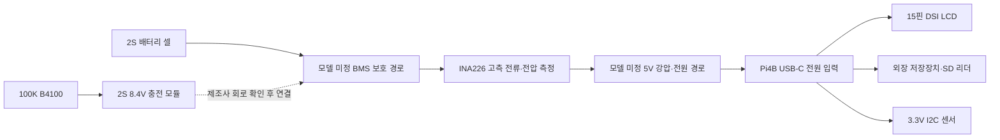

# MEBS Pi4B 하드웨어 변경 설계 Rev A

2026-10-18. **변경 설계와 OS 연결부 개발본**이다. 제작 완료 PCB/회로 검증/실물 동작 확인을 의미하지 않는다. 기존 OS 이미지·소스는 보존하고 별도 `mebs-pi4-dsi` 프로필에 적용한다.

## 기존 요구 → 변경 요구 → 실제 코드 상태

| 항목 | 변경 전 요구/기록 | 새 하드웨어 설계 | OS 적용 상태 |
|---|---|---|---|
| 기준 보드 | 과거 OrangePi 최종/Pi 프로토타입 기록 | 이번 개발 **Raspberry Pi4B ARM64** | 별도 Buildroot2026.08 프로필 |
| LCD |4인치 SPI/480×320 요구 기록. 실제 GitHub Pi4 설정은 HDMI |5인치15핀 DSI 800×480 가로,24비트,약60Hz 목표 |KMS/DRM·800UI·evdev 경로 구현. 모델 미확정이라 특정 panel/touch overlay 비활성 |
| SPI |LCD용 SPI 요구 |SPI LCD 출력 제외, 다른 SPI 장치용 버스는 임의 제거하지 않음 |조사된 소스에는 SPI LCD 설정이 없어 제거 변경 없음 |
| 전압/전류 |이전 제안과 구분 |INA226,3.3V I²C |버스/션트 변환·ID 확인·주소 검사. 실물 션트/정격 미확정으로 비활성 |
| 조도 |수동 밝기 |BH1750 자동 밝기 추가 |필터·변화 제한·수동 fallback·설정 저장 |
| 시계 |시스템 시계 |DS3231 RTC 추가 |kernel hwclock 복원 연결 및 UTC/OSF 테스트. 실제 driver/device는 미확정 |
| 온도 |100K B3950×2/ADS1115/분압 제안 |모두 제외. CPU 내부 온도만 표시 |ADS1115·배터리/케이스 온도 UI 없음 |
| 충전 NTC |다른 NTC와 혼동 가능 |100K B4100 하나, 충전 모듈 NTC 입력 전용 |Pi GPIO/ADC 연결 없음 |
| 배터리 |사양 미정 |사용자 확인8.4V,2S 완충 전압으로 기록 |BMS/셀/용량 미확정. 임의 저전압 임계값 없음 |
| Pi 전원 |구체 전원 경로 미정 |2S 배터리와 Pi 사이 **별도5V 강압 전원 단계 필요** |전원 제어가 아닌 설계 요구. 부품/부하 실측 미정 |
| 종료 |OS 종료/배터리 전원 혼동 |OS sync·로그·안전 종료, 백업 중 완료 후 예약 |종료 경계 테스트. GPIO 실제 전원 차단 없음 |
| 부저/진동/SATA |과거 제안 |모두 제외 |제어 코드/사용 패키지 추가 없음 |
| USB 역할 |수정금지.txt/.text 표식 제안 |첫 USB=백업 대상, 두 번째=원본 SD |순서 판별 구현. 모호하면 모두 분리 후 재연결 |
| 부팅 로고 |embedded Base85 손상 |사용자 제공1000065842.jpg에서 실제 MEBS 로고 사용 |원본 JPEG 보존·mask 추출·패키징·페이드/진행률 연결 완료(모의) |

## 전원 구조 — 기능 블록 설계, 제작용 확정 회로 아님

- **8.4V를 Pi4B 5V 입력이나 GPIO에 직접 연결하지 않는다.** INA226의 VS 센서 전원도3.3V이며, VBUS/션트 고전압 측정 단자와 구분한다.
- 충전 모듈은2S 충전용 boost 설명이다. Pi 공급용5V buck이나 안전한 load sharing 기능이 포함됐다고 간주하지 않는다.
- Pi4B 전원 설계 기준으로5.1V/3A급을 참고하되 LCD·외장 하드 기동전류·USB 리더 등을 합산해 실제 시스템 전원 정격을 결정해야 한다. 3A가 전체 구성에 충분하다고 보장하지 않는다. Pi의 USB 전력 한도와 저장장치 기동 부하도 따로 검증한다.
- BMS가 공통 포트인지 충전/방전 분리형인지에 따라 P-/C- 연결이 달라진다. 충전기·BMS 회로와 power-path/load-sharing이 미확정이므로 배터리 단자별 확정 결선도/부품값/제조 Gerber는 만들지 않았다. 셀 midpoint BM은 제조사2S 회로에서 지정한 감지/밸런싱용이며 임의 부하 접지로 쓰지 않는다.
- INA226의 측정 위치는 보호된 배터리 고측을 기본안으로 한다. 실제 충전/방전의 양방향 전류를 읽으려면 충전기와 부하 전류가 모두 통과하는 측정 노드를 회로에서 확정해야 한다. 전류 방향 부호는 실물로 확인 후 설정한다.
- 저전압은 실제 셀·BMS 차단전압보다 먼저 정상 종료할 여유를 측정해 확정한다. 8.4V를 저전압 기준으로 쓰지 않는다. 추정 SOC/사용시간은 실물 OCV/용량/전류 보정 전 미표시다.

## 커넥터와 주소 계획

`hardware/wiring-pi4b.csv`에 배선표, `hardware/mebs-pi4b-revA.json`에 설계 요구와 미확정 값을 기록했다.

| Pi4B | 연결 |
|---|---|
|물리1 /3.3V|센서 VS/VCC. 해당 모듈의3.3V 및 풀업 검증 후 연결 |
|물리3 /GPIO2 SDA|INA226/BH1750/DS3231 SDA |
|물리5 /GPIO3 SCL|위 센서 SCL |
|물리6 /GND|센서 기준 접지 |
|15핀 DSI|LCD 케이블. 제품 pinout·케이블 방향 확인 |
|USB-C|검증된5V 전원 단계의 출력 |

예정 주소: INA2260x40, BH17500x23(대체0x5C), DS32310x68. 이는 실측 주소가 아니다. INA226 A0/A1과 BH1750 ADDR, DSI 터치의 버스/주소를 확인해야 한다. 센서의 풀업이5V에 연결된 모듈이면 그대로 Pi에 연결하지 않는다. DS3231 모듈의 백업 전지 종류와 충전 회로 유무도 확인한다.

## OS 연결부와 활성화 조건

새 `mebs/hardware_profile.py`는 live 모드에서 다음을 검사한다.

- 활성 센서가 있으면 `i2c_logic_3v3_confirmed=true` 필요.
- INA226 전류 환산을 활성화하면 양수 션트·정격전력·최대전류가 필요. I²R 정격 초과와 INA226 ±81.92mV 측정 범위 초과를 거부한다. 정격값 자체는 반드시 모듈 자료/실측으로 확인해야 한다. 이 검사만으로 열/전원 설계가 검증된 것은 아니다.
- 배터리 보호 임계값은 `battery_bms_confirmed=true`, 올바른 warn/block 순서, INA 측정 설정이 있을 때만 허용한다.
- DSI DRM 출력·터치 장치 활성화는 해당 controller 확인 flag가 있어야 한다. 출력 미설정 상태의 headless 백업은 막지 않는다.
- GPIO 배터리 차단 활성화는 거부한다.

기본 hardware.json은 미확정 항목을false/null로 유지한다. 단순히 해상도나8.4V를 입력했다고 실물 기능을 활성화하지 않는다. flag는 자동 실측 인증이 아니라 담당자가 실제 자료/배선을 확인한 뒤 지정하는 설정이다.

실제 Pi의 기존 부팅 OS에서 `python3 scripts/pi4-hardware-report.py --output hardware-report.json`을 실행하면 이미 등록된 DRM/I²C/터치 driver 정보를 읽기 전용으로 수집할 수 있다. 자동 I²C 스캔/쓰기나 GPIO 조작은 하지 않는다. 클라우드에서는 실제 Pi에 접근할 수 없다.

## 첨부 로고 적용

`mebs/assets/mebs-boot-reference.jpg`는 첨부 JPEG 원본과 바이트가 같다. `scripts/prepare-logo.py`가 원본(1280×853)에서(315,195)~(978,335)의 MEBS 글자 영역만 grayscale mask로 추출한다. 검정 JPEG 잡음 값<12만 제거하고 글자 모양을 생성/재디자인하지 않는다. crop·SHA-256은 `logo-provenance.json`에 기록한다. 기존 제작자 표기는 이미지와 동일하게 유지한다.

부팅 렌더러는 이 실제 mask를 사용하며 손상된 embedded 데이터는 원문 보존된 fallback 경로로 남는다. Buildroot MEBS 패키지에 mask와 provenance 설치를 추가했다. 초기 화면의78%를 고정 복사하지 않고 실제 준비 단계값으로 진행 게이지를 그린다. 미리보기는 모의 준비 단계이며 실기기 준비/시간을 증명하지 않는다.

최신 미리보기: `artifacts/boot-applied/boot-demo.gif`, `boot-progress.png`, `boot-ready.png`.

## 결과와 아직 필요한 실물 자료

자동 테스트118개 통과. 로고 provenance/zipapp 패키징/잘못된 하드웨어 설정 거부를 호스트에서 검증했다. 실제 DSI/터치/센서·전원 회로·배터리 내구성/PCB 제조는 미실시다. 이미지 빌드403 차단도 별도 미해결이다.

남은 자료: LCD 제품명/PCB revision/터치 칩, INA226 션트 인쇄·저항 정격, 배터리 셀·용량, BMS 모델/차단전압/연속·피크 전류,5V 강압기 모델·실부하 정격, 충전기의 load sharing/power-path 회로. 자료 없이 정확한 부품값이나 제작 가능 PCB를 확정하지 않는다.
