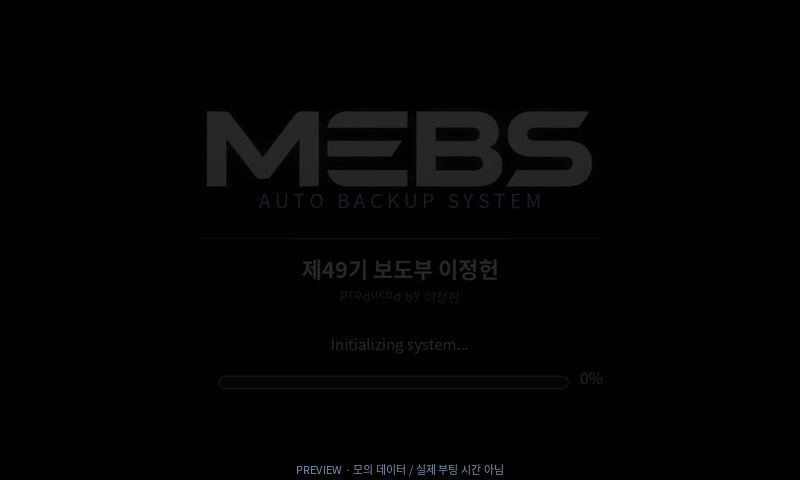

# MEBS ver 1 — 다른 기기 개발 인계

**사용자가 UI를 결정한 Raspberry Pi 4B용 Buildroot 개발 기준본입니다. 부팅 가능한 `.img`는 아직 생성되지 않았습니다.**

- 목표: Raspberry Pi 4B / ARM64 / Buildroot2026.08 /5인치 DSI800×480 터치.
- 확정 디자인: 사용자 제공 MEBS 로고, 검정·청록색, `제49기 보도부 이정헌`, **`Produced by 이정헌`**.
- 저장장치: 첫 USB=백업 대상 → STORAGE READY 확인 → 두 번째 USB=원본 SD. 표식 파일 사용 안 함.
- 검증: 호스트 자동 테스트 **118개 통과**. UI 프리뷰는 모의 입력입니다.
- 차단: Buildroot host-pkgconf 다운로드에서 프록시 CONNECT403. QEMU/실물 부팅·실물 센서/전원 시험은 미실시.
- 미확정: LCD/터치 모델, INA226 션트·정격, 셀/BMS,5V 강압기·load-sharing.8.4V는 사용자 제공2S 완충 정보입니다.

## 먼저 읽기

1. [기안서](01_기안서.md)
2. [목표서·완료 기준](02_목표서.md)
3. [현재 개발 현황](03_개발현황.md)
4. [다른 기기 인계서·재현 명령](04_인계서.md)
5. [하드웨어 변경표](05_하드웨어변경표.md)
6. [테스트 계획](06_테스트계획.md)
7. [확정 결정사항](07_결정사항.md)
8. [다음 작업 순서](08_다음작업.md)

실행 소스는 저장소 루트의 `mebs/`, `scripts/`, `buildroot/`, `tests/`, `hardware/`입니다. 이 폴더는 해당 소스의 ver1 기준·결정·화면·증거·인계 지침을 고정합니다. `SOURCE_MANIFEST.json`에 인계 시 소스별 SHA-256을 기록했습니다. 이후 소스를 바꾸면 이 문서는 이전 기준 기록으로 보존하고 다음 버전의 변경을 명시하세요.

## 결정된 UI 프리뷰

[대표 화면 전체](ui/storyboard.jpg) · [개별 화면·선택형 HTML](ui/) · [검증 증거](evidence/)

HTML은 파일을 로컬에서 열면 장면 선택/재생을 지원합니다. GitHub 페이지에서는 HTML 소스로 보일 수 있습니다. 그림 버튼은 모의 장면만 전환하며 복사/마운트/전원 종료를 실행하지 않습니다.

기존 Debian ARM64 Windows-QEMU ZIP이나 다른 x86 ISO 준비본은 이번 Pi4B Buildroot 이미지가 아닙니다. GitHub에 그 대용량 이미지·패키지·캐시를 업로드하지 않습니다. 전원 종료는 OS 안전 종료이며 실제 배터리 전원 차단은 구현하지 않습니다.
